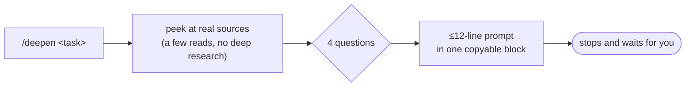

<div align="center">



**Your lazy prompt, rewritten the way a senior pro would have asked for it.**
*Prompt in, deeper prompt out. No work starts until you say go.*

[](https://agentskills.io)
[](LICENSE)
[](skills/deepen/SKILL.md)
[](#design-notes)
[](https://github.com/elrazez/deepen/releases/latest)

`claude.ai` · `Claude Code` · `Claude API` · `Hermes Agent` · `Codex` · `Cursor` · `Gemini CLI` · `GitHub Copilot` · `OpenCode` · [+ ~70 more](#every-other-agent)

</div>

---

```text
you   > /deepen make our landing page load faster on mobile
agent > (reads a few real sources, answers 4 questions, hands back a ≤12-line prompt, stops)
```

> [!NOTE]
> **Where the idea comes from:** Felix Rieseberg's [*How to be more ambitious: A tutorial for humans with models*](https://felixrieseberg.com/how-to-be-more-ambitious-a-tutorial-for-humans-with-models/). Felix works on Claude at Anthropic. He splits ambition with models into speed, altitude, depth and range. Depth means "considering a task the way a field-leading expert would": one level below the task's layer, down to the underlying data, tools and problems. His depth section closes with a four-question prompt. `deepen` packages that prompt as a skill you can call with one command.

## TL;DR

You type the prompt you'd normally type. `deepen` asks the four questions a top professional in
that field would ask, then gives you back the prompt you *should* have written. That prompt names
the raw sources to start from, the tools to use, and a pass/fail check that doesn't depend on the
model grading itself. Same task, same scope, more depth. Then it stops and waits for you.

It's one Markdown file. No scripts, no API keys, no dependencies.

## Why

Agents do what you ask, and that's the problem. "Make the page faster" gets you a Lighthouse score
and a list of generic tips. A performance engineer starts from field data at p75, breaks the slow
metric into its parts, changes one thing at a time, and calls it done only when CrUX says so.
`deepen` turns the first prompt into the second before any work starts.

## How it works



| # | The question | What it rules out |
|:-:|---|---|
| 1 | What would a **top professional** in this field do here that you're not asking for? | The junior-level answer |
| 2 | What's the **rawest material** they'd start from? Exact files, data, primary sources, measurements. | Second-hand summaries |
| 3 | Which **specific methods and tools** would they use, preferring the ones actually available? | "Optimize it", "follow best practices" |
| 4 | What, **other than the assistant or you**, would show the result is right? A check that can pass or fail. | "Looks good to me" |

Three rules hold it together:

- **Deeper, not bigger.** A rewrite that adds features or deliverables you didn't ask for fails.
- **Concrete or nothing.** Every answer names real files, data, tools or checks, not generic advice.
- **It doesn't do the work.** You get a prompt. Paste it, edit it, or say "run it".

## Demo

Real, unedited output from Claude Code with only this skill installed, run in an empty directory with no MCP servers
([full transcript](examples/landing-page-mobile.md) · [another example](examples/postgres-vs-sqlite-post.md)).

```text
/deepen make our landing page load faster on mobile
```

<details>
<summary><b>The four answers</b> (click to expand)</summary>

I couldn't look at the actual landing page: this directory only has the deepen skill file, with no site code, build config or URL. So the answers below name the sources the rewritten prompt should pull rather than specific files.

**1. What a top professional would do that you didn't ask for**
- Measure real mobile visitors first (field data, 75th percentile), not a lab score from a fast laptop, and pick the one metric that's actually failing: LCP, INP or CLS.
- Find the single element that shows up last in the first screen (the LCP element, usually the hero image or headline font) and fix how it gets requested before touching anything else.
- Cap total page weight and set a time limit for mobile, then add a check that fails the build when a change goes over them.

**2. The rawest material to start from**
- Chrome UX Report (CrUX) field data for the landing URL: phone visitors, LCP/INP/CLS at the 75th percentile, from the PageSpeed Insights API or the CrUX History API.
- A Chrome DevTools performance trace and the network waterfall (HAR file) recorded with "Slow 4G" and 4× CPU throttling: request order, blocking CSS/JS, the hero image's size and priority.
- The production build output: bundle sizes from the build stats and a list of third-party scripts, plus the raw HTML the server returns (`curl -s <url>`).

**3. Methods and tools**
- `npx lighthouse <url> --form-factor=mobile --throttling-method=devtools` run 5 times, taking the median, and `npx unlighthouse` if there are several landing variants.
- WebPageTest on a Moto G-class phone over 4G: filmstrip view, LCP breakdown (time to first byte, load delay, load time, render delay).
- Targeted fixes: `fetchpriority="high"` and a preload for the LCP image, AVIF/WebP with `srcset`/`sizes`, critical CSS inlined, fonts set to `font-display: swap` and preloaded, non-essential JS deferred, third-party scripts loaded after the page settles.

**4. Checks that pass or fail on their own**
- CrUX phone data at p75, 28 days after deploy: LCP ≤ 2.5 s, INP ≤ 200 ms, CLS ≤ 0.1 (Google's "good" thresholds).
- Lighthouse CI (`@lhci/cli`) budget assertions in CI: mobile performance score, LCP, and the JS/image byte budgets.
- Real user behaviour: mobile bounce rate and conversion on the landing page in your analytics, before vs. after.

</details>

**The prompt it hands back:**

```text
Make our landing page load faster on mobile. Don't add features or redesign anything.
1. Baseline: pull CrUX phone data for the landing URL (PageSpeed Insights API) at p75 for LCP, INP and CLS.
   Then run Lighthouse mobile 5 times and take the median, and record one throttled DevTools trace (Slow 4G, 4x CPU).
2. Identify the LCP element and break its time into TTFB, load delay, load time and render delay. Also list the
   render-blocking CSS/JS, the size of each JS bundle and every third-party script, with their bytes.
3. Fix the biggest contributors in order of measured impact: LCP image priority/format/srcset, critical CSS,
   font loading, deferring non-critical JS and third parties. Make one change at a time and re-measure after each.
4. Add Lighthouse CI with budgets: mobile LCP ≤ 2.5 s, CLS ≤ 0.1, and JS/image byte caps set from the new numbers.
5. Report a before/after table (median Lighthouse plus trace numbers) and note what to re-check in CrUX
   28 days after deploy (target: p75 LCP ≤ 2.5 s, INP ≤ 200 ms, CLS ≤ 0.1).
```

## Install

### The one-liner: ~80 agents

```bash
npx skills add elrazez/deepen          # this project's agents (asks which)
npx skills add elrazez/deepen -g       # global, every project
npx skills add elrazez/deepen -g -a claude-code -a codex -y   # specific agents, no prompts
```

This uses [`vercel-labs/skills`](https://github.com/vercel-labs/skills), which finds the agents you
have installed and puts the skill in each one's folder. For anything it doesn't cover, use the
per-agent steps below.

### Per agent

| Agent | Install | Invoke |
|---|---|---|
| **claude.ai** (web, desktop, mobile, Cowork) | [Ask Claude](#claudeai) or [upload the zip](#claudeai) | `/deepen <task>` |
| **Claude Code** | [Ask Claude](#claudeai) or `~/.claude/skills/deepen/` ([cmd](#manual-install-any-agent)) | `/deepen <task>` |
| **Claude API** | [`POST /v1/skills`](#claude-api) | `container.skills` |
| **Hermes Agent** | `hermes skills install elrazez/deepen/skills/deepen` | `/deepen <task>` |
| **Codex** (CLI, IDE, ChatGPT desktop) | `~/.agents/skills/deepen/` | `$deepen <task>` |
| **Cursor** | `~/.cursor/skills/deepen/` or `~/.agents/skills/deepen/` | `/deepen <task>` |
| **Gemini CLI** | `~/.gemini/skills/deepen/` or `~/.agents/skills/deepen/` | `deepen this prompt: <task>` |
| **GitHub Copilot** | `~/.copilot/skills/deepen/` or `~/.agents/skills/deepen/` | `deepen this prompt: <task>` |
| **OpenCode** | `~/.config/opencode/skills/deepen/` (also reads `~/.claude/skills`, `~/.agents/skills`) | `/deepen <task>` |
| **Anything else** | [See below](#every-other-agent) | |

> [!TIP]
> **`~/.agents/skills/` is the closest thing to a universal path.** Codex, Cursor, Gemini CLI,
> GitHub Copilot, OpenCode, Cline, Warp, Zed and Pi all read it. Install there and in
> `~/.claude/skills/` and most agents on your machine will find it.

### Manual install (any agent)

```bash
# Pick your agent's skills folder (table above, or the full list below):
DEST=~/.agents/skills        # Codex, Cursor, Gemini CLI, Copilot, OpenCode, Cline, Warp, Zed, Pi
# DEST=~/.claude/skills      # Claude Code
# DEST=~/.hermes/skills      # Hermes Agent

mkdir -p "$DEST/deepen" && curl -fsSL \
  https://raw.githubusercontent.com/elrazez/deepen/main/skills/deepen/SKILL.md \
  -o "$DEST/deepen/SKILL.md"
```

To scope it to one repo, use the project folder instead (`.claude/skills/`, `.agents/skills/`, …) and commit it.

<a id="claudeai"></a>
### claude.ai and Claude Code

**The easy way: let Claude install it.** Paste this into a claude.ai chat or a Claude Code session:

```text
Install the "deepen" Agent Skill from https://github.com/elrazez/deepen for me.
Use skills/deepen/SKILL.md from that repo exactly as it is. Don't edit, rewrite or summarize it.
- Claude Code: download it with curl (not a web-fetch tool, so the file stays byte-exact) from
  https://raw.githubusercontent.com/elrazez/deepen/main/skills/deepen/SKILL.md
  to ~/.claude/skills/deepen/SKILL.md (create the folder), then show me its first 8 lines.
- claude.ai: in your sandbox run `git clone --depth 1 https://github.com/elrazez/deepen`,
  package the skills/deepen folder as a skill file, and give it to me to save.
Then tell me how to use it: /deepen <task>
```

- **Claude Code** asks before writing to `~/.claude/`, which it treats as a protected folder. Approve that one write. `/deepen` works right away, with no restart.
- **claude.ai** needs **Settings → Capabilities → Code execution and file creation** turned on. The sandbox can reach `github.com` by default. Save the skill file Claude hands back. If your organization has network access off, use the zip below.

**Or upload the zip yourself (claude.ai):**

1. Download **[`deepen.zip`](https://github.com/elrazez/deepen/releases/latest/download/deepen.zip)**.
2. Make sure **Settings → Capabilities → Code execution and file creation** is on.
3. Go to **[Customize → Skills](https://claude.ai/customize/skills)** → **+** → **Create skill** → **Upload a skill**, and pick the zip.
4. Toggle it on. Type `/deepen <task>` or "deepen this prompt: …" in any chat.

Skills on your claude.ai account also load in Claude Desktop, Cowork and cloud sessions, and they
sync to Claude Code in the terminal when you're signed in with that account.

### Claude API

```bash
curl -fsSL -o deepen.zip https://github.com/elrazez/deepen/releases/latest/download/deepen.zip
unzip -q deepen.zip                                   # -> deepen/SKILL.md

curl -X POST https://api.anthropic.com/v1/skills \
  -H "x-api-key: $ANTHROPIC_API_KEY" \
  -H "anthropic-version: 2023-06-01" \
  -F "files[]=@deepen/SKILL.md;filename=deepen/SKILL.md"
```

Then pass `{"type": "custom", "skill_id": "<id from the response>", "version": "latest"}` in
`container.skills`, with the code execution tool enabled. See
[Using Agent Skills with the API](https://platform.claude.com/docs/en/build-with-claude/skills-guide).

### Hermes Agent

```bash
hermes skills install elrazez/deepen/skills/deepen
```

Sessions that are already running cache their slash-command list, so run `/reload-skills` once
in an open chat (or restart it) before `/deepen` shows up.

<a id="every-other-agent"></a>
### Every other agent

<details>
<summary><b>Full path table</b>: every agent <code>npx skills</code> knows about (click to expand)</summary>

Copy `skills/deepen/` into the folder below, or run `npx skills add elrazez/deepen -a <flag>`.
Paths come from the [`vercel-labs/skills` README](https://github.com/vercel-labs/skills#supported-agents)
as of October 2026. If an agent has moved its folder since then, check that agent's own docs.

| Agent | `--agent` | Project Path | Global Path |
|-------|-----------|--------------|-------------|
| AiderDesk | `aider-desk` | `.aider-desk/skills/` | `~/.aider-desk/skills/` |
| Amp, Replit, Universal | `amp`, `replit`, `universal` | `.agents/skills/` | `~/.config/agents/skills/` |
| Antigravity | `antigravity` | `.agents/skills/` | `~/.gemini/antigravity/skills/` |
| Antigravity CLI | `antigravity-cli` | `.agents/skills/` | `~/.gemini/antigravity-cli/skills/` |
| AstrBot | `astrbot` | `data/skills/` | `~/.astrbot/data/skills/` |
| Autohand Code CLI | `autohand-code` | `.autohand/skills/` | `~/.autohand/skills/` |
| Augment | `augment` | `.augment/skills/` | `~/.augment/skills/` |
| IBM Bob | `bob` | `.bob/skills/` | `~/.bob/skills/` |
| Claude Code | `claude-code` | `.claude/skills/` | `~/.claude/skills/` |
| OpenClaw | `openclaw` | `skills/` | `~/.openclaw/skills/` |
| Cline, Codex, Dexto, fx, Kimi Code CLI, Loaf, Pi, Sarvam Code, Warp, Zed | `cline`, `codex`, `dexto`, `fx`, `kimi-code-cli`, `loaf`, `pi`, `sarvam-code`, `warp`, `zed` | `.agents/skills/` | `~/.agents/skills/` |
| CodeArts Agent | `codearts-agent` | `.codeartsdoer/skills/` | `~/.codeartsdoer/skills/` |
| CodeBuddy | `codebuddy` | `.codebuddy/skills/` | `~/.codebuddy/skills/` |
| Codemaker | `codemaker` | `.codemaker/skills/` | `~/.codemaker/skills/` |
| Code Studio | `codestudio` | `.codestudio/skills/` | `~/.codestudio/skills/` |
| Command Code | `command-code` | `.commandcode/skills/` | `~/.commandcode/skills/` |
| Continue | `continue` | `.continue/skills/` | `~/.continue/skills/` |
| Cortex Code | `cortex` | `.cortex/skills/` | `~/.snowflake/cortex/skills/` |
| Crush | `crush` | `.crush/skills/` | `~/.config/crush/skills/` |
| Cursor | `cursor` | `.agents/skills/` | `~/.cursor/skills/` |
| Deep Agents | `deepagents` | `.agents/skills/` | `~/.deepagents/agent/skills/` |
| Devin for Terminal | `devin` | `.devin/skills/` | `~/.config/devin/skills/` |
| Droid | `droid` | `.agents/skills/` | `~/.factory/skills/` |
| Eve | `eve` | `agent/skills/` | N/A (project-only) |
| Firebender | `firebender` | `.agents/skills/` | `~/.firebender/skills/` |
| ForgeCode | `forgecode` | `.forge/skills/` | `~/.forge/skills/` |
| Gemini CLI | `gemini-cli` | `.agents/skills/` | `~/.gemini/skills/` |
| GitHub Copilot | `github-copilot` | `.agents/skills/` | `~/.copilot/skills/` |
| Goose | `goose` | `.goose/skills/` | `~/.config/goose/skills/` |
| Grok Build | `grok` | `.grok/skills/` | `~/.grok/skills/` |
| Hermes Agent | `hermes-agent` | `.hermes/skills/` | `~/.hermes/skills/` |
| inference.sh | `inference-sh` | `.inferencesh/skills/` | `~/.inferencesh/skills/` |
| Jazz | `jazz` | `.jazz/skills/` | `~/.jazz/skills/` |
| Junie | `junie` | `.junie/skills/` | `~/.junie/skills/` |
| iFlow CLI | `iflow-cli` | `.iflow/skills/` | `~/.iflow/skills/` |
| Kilo Code | `kilo` | `.agents/skills/` | `~/.kilo/skills/` |
| Kimchi | `kimchi` | `.kimchi/skills/` | `~/.config/kimchi/harness/skills/` |
| Kiro CLI | `kiro-cli` | `.kiro/skills/` | `~/.kiro/skills/` |
| Kode | `kode` | `.kode/skills/` | `~/.kode/skills/` |
| Lingma | `lingma` | `.lingma/skills/` | `~/.lingma/skills/` |
| MCPJam | `mcpjam` | `.mcpjam/skills/` | `~/.mcpjam/skills/` |
| MiniMax Code | `minimax-code` | `.minimax/skills/` | `~/.minimax/skills/` |
| Mistral Vibe | `mistral-vibe` | `.vibe/skills/` | `~/.vibe/skills/` |
| Moxby | `moxby` | `.moxby/skills/` | `~/.moxby/skills/` |
| Mux | `mux` | `.mux/skills/` | `~/.mux/skills/` |
| OpenCode | `opencode` | `.agents/skills/` | `~/.config/opencode/skills/` |
| OpenHands | `openhands` | `.openhands/skills/` | `~/.openhands/skills/` |
| Ona | `ona` | `.ona/skills/` | `~/.ona/skills/` |
| Posit Assistant | `posit-assistant` | `.posit/assistant/skills/` | `~/.posit/assistant/skills/` |
| Qoder | `qoder` | `.qoder/skills/` | `~/.qoder/skills/` |
| Qoder CN | `qoder-cn` | `.qoder/skills/` | `~/.qoder-cn/skills/` |
| Qwen Code | `qwen-code` | `.qwen/skills/` | `~/.qwen/skills/` |
| Reasonix | `reasonix` | `.reasonix/skills/` | `~/.reasonix/skills/` |
| Rovo Dev | `rovodev` | `.rovodev/skills/` | `~/.rovodev/skills/` |
| Roo Code | `roo` | `.roo/skills/` | `~/.roo/skills/` |
| Tabnine CLI | `tabnine-cli` | `.tabnine/agent/skills/` | `~/.tabnine/agent/skills/` |
| Terramind | `terramind` | `.terramind/skills/` | `~/.terramind/skills/` |
| Tinycloud | `tinycloud` | `.tinycloud/skills/` | `~/.tinycloud/skills/` |
| Trae | `trae` | `.trae/skills/` | `~/.trae/skills/` |
| Trae CN | `trae-cn` | `.trae/skills/` | `~/.trae-cn/skills/` |
| Windsurf | `windsurf` | `.windsurf/skills/` | `~/.codeium/windsurf/skills/` |
| ZCode | `zcode` | `.zcode/skills/` | `~/.zcode/skills/` |
| Zencoder, Zenflow | `zencoder`, `zenflow` | `.zencoder/skills/` | `~/.zencoder/skills/` |
| Neovate | `neovate` | `.neovate/skills/` | `~/.neovate/skills/` |
| Pochi | `pochi` | `.pochi/skills/` | `~/.pochi/skills/` |
| PromptScript | `promptscript` | `.agents/skills/` | N/A (project-only) |
| AdaL | `adal` | `.adal/skills/` | `~/.adal/skills/` |

</details>

**No skill support at all?** (A plain chat UI, a local model, a custom GPT.) Paste everything
below the `---` frontmatter in [`SKILL.md`](skills/deepen/SKILL.md) into the system prompt or
custom instructions, then write `/deepen <task>`.

## Usage

```text
/deepen <task>               # Claude Code, claude.ai, Hermes, Cursor, OpenCode
$deepen <task>               # Codex
deepen this prompt: <task>   # Gemini CLI, Copilot, any agent that picks skills by description
```

You get four short lists and one fenced block. Paste the block into a fresh chat, hand it to
another agent, or just say **"run it"**.

### Give it project context

Put a project-specific `deepen` file in a repo, at `.claude/skills/deepen/SKILL.md` or
`.agents/skills/deepen/SKILL.md`. List that project's real sources (dashboards, data exports,
test commands, style guides) and its checks. Step 2 of the skill reads that file first, so the
answers point at *your* data instead of the general case.

## Design notes

- **One file, zero deps.** No scripts, so it runs anywhere Agent Skills run, including the claude.ai sandbox and the API container, which have no network access.
- **The frontmatter uses only spec fields** (`name`, `description`, `license`, `metadata`). claude.ai and the Skills API reject any extra key with `Unexpected key(s) in SKILL.md frontmatter`. Agent-specific switches go inside `metadata` as strings. `opencode/slash: "true"`, for example, gives OpenCode its `/deepen` command.
- **The description is ≤ 60 characters and starts with the trigger.** Some agents (Hermes, for one) cut skill descriptions at 60 characters in the system prompt, so the trigger has to fit.
- **12-line cap on the prompt.** That's long enough to name sources, tools and a check, and short enough to paste.

```text
.
├── skills/deepen/SKILL.md   the whole skill
├── examples/                real, unedited runs
├── assets/banner.svg        the header image
├── scripts/package.py       builds dist/deepen.zip (stdlib only, reproducible)
├── scripts/banner.py        draws assets/banner.svg (stdlib only)
└── LICENSE                  MIT
```

## FAQ

<details><summary><b>Does it do the task?</b></summary>

No. It stops after the rewrite on purpose. If you want the work done, say "run it" or paste the
block wherever you want it run.
</details>

<details><summary><b>How is this different from "rewrite my prompt to be better"?</b></summary>

Generic rewrites mostly add adjectives and structure. `deepen` makes the model commit to specific
raw sources, specific tools, and a check that can actually fail. A deeper prompt has to name
those; a "better" one doesn't.
</details>

<details><summary><b>Won't it blow up the scope?</b></summary>

That's the first rule it checks itself against: *deeper, not bigger*. It doesn't add new
features or deliverables.
</details>

<details><summary><b>It ran without me typing /deepen.</b></summary>

Some agents pick skills from their descriptions, and this one fires on "wants a deeper prompt".
If you want it to run only when you type the command, Claude Code supports
`disable-model-invocation: true` in the frontmatter. That's a Claude Code-only key, so leave it
out of the copy you upload to claude.ai.
</details>

## Contributing

Issues and PRs are welcome, especially new [examples](examples/) from other agents and fields.
Keep the skill to one file and keep the rule: **deeper, not bigger.**

## License

[MIT](LICENSE)
